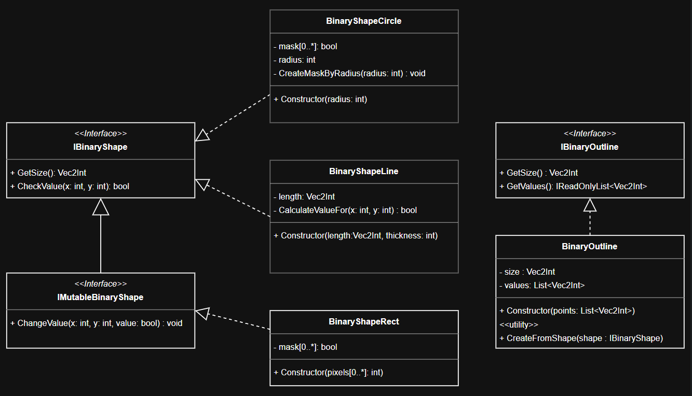
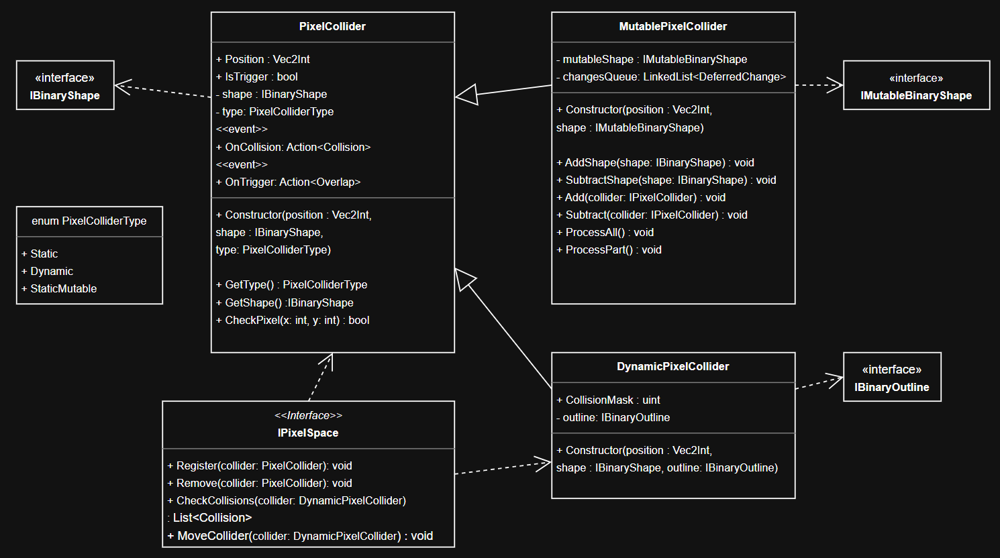

# Детали реализации

Каждый пиксель в данной системе описывается типом bool (есть/нет).\
Начало координат: (0;0) - левый нижний угол. X - увеличивается вправо, Y - вверх. Значения имеют тип `int`.

## Формы и контуры

Это сущности, которыми оперируют коллайдеры. Они задают форму и размер пиксельного фрагмента и позволяют хранить в памяти один объект-представление, который может использоваться несколькими коллайдерами. Их основная задача: предоставлять доступ к значениям пикселей при запросах.

(серая обводка на UML у не реализованных классов)

По назначению:
+ `IBinaryShape` - черта статических коллайдеров. Реализация предоставляет значения пикселей (true/false), при запросах по координатам x,y (от [0;0] до [size.x-1;size.y-1]).
+ `IBinaryOutline` - черта динамических коллайдеров. Реализация хранит координаты пикселей только со значениями true и продоставляет их, как список.

Форма (как и контур) не обязанна хранить данные (например, как массив, созданный по текстуре).
Для экономии памяти, это может быть просто функция f(x,y), возвращающая true/false или сжатое представление массива пикселей.

## Коллайдеры и их взаимодействие

Коллайдеры:
+ статический неизменяемый (PixelCollider);
+ статический изменяемый (MutablePixelCollider);
+ динамический неизменяемый (DynamicPixelCollider).

Для отслеживания взаимодейстий, коллайдеры, регистрируются в пиксельном пространстве (PixelSpace) на нужный слой.
PixelSpace позволяет перемещать только `DynamicPixelCollider`.

Столкновения отслеживаются только в момент перемещения динамического коллайдера. Если по пути к точке назначения `DynamicPixelCollider` столкнулся, он останасливается без продолжения движения. При столкновении вызывается событие OnCollision у обоих участников. Разрешение коллизий остаётся за подписчиками на события. Статические коллайдеры не взаимодействуют друг с другом.

## Физика (планы)

Планируется добавить:
+ `PhysicsBody` - только симуляция (притяжение, отскоки, трение);
+ `KinematicBody` - симуляция + есть методы управления из кода (приложить силу, скорость и т.д.).
